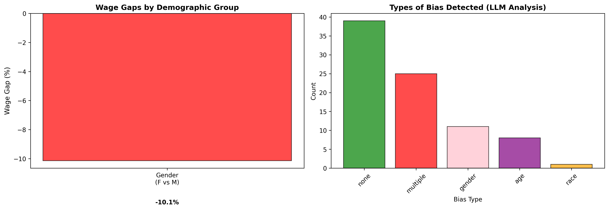
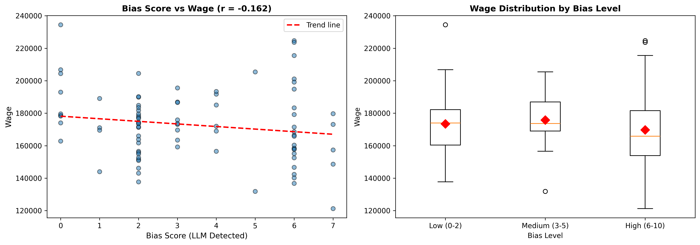
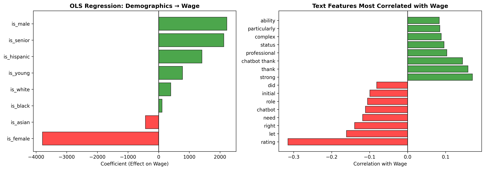

# Detecting Wage Discrimination in Hiring Text

Is there discrimination in this labour market, and can an LLM help find it? This project analyses a simulated hiring dataset of hiring-team discussions and chatbot interview transcripts. Candidate demographics aren't recorded anywhere, so they have to be inferred from the text. I combined an LLM (OpenAI `gpt-4o-mini`) with keyword extraction to infer gender, race and age, scored each case for bias, and tested whether wages differ across groups.

Built for the final project in ECON 424: Machine Learning for Economists, University of Waterloo (Fall 2025).



## Key findings

**There is evidence of a gender wage gap. There is no evidence of a racial one.**

| Group (hired candidates) | N | Mean wage | Gap vs reference |
|---|---|---|---|
| Male | 1,268 | $174,460 | — |
| Female | 1,754 | $168,424 | **−$6,036 (−3.5%)**, p < 0.001 |
| White | 1,020 | $171,604 | — |
| Black | 620 | $171,378 | −0.1% |
| Hispanic | 425 | $172,643 | +0.6% |
| Asian | 1,287 | $170,822 | −0.5% |

- **Gender:** across 4,372 hired candidates, women identified by keyword were paid about $6,000 (3.5%) less than men. A Welch t-test gives t ≈ −9.6 (p < 0.001). In the LLM-labelled sample the gap was wider, at **−10.1%**.
- **Race:** mean wages for all four groups sit within 1.1% of each other, so the data show no meaningful racial wage gap.
- **Bias in the text:** the LLM assigned a bias type other than "none" in 54% of the 84 hired cases it scored (45 of 84). "Multiple" types was the most common category, followed by gender and age. Higher bias scores were weakly associated with lower wages (r = −0.16).
- **Regression:** in an OLS regression of wage on the inferred demographics, the female indicator has the largest negative coefficient (about −$3,800) and the male indicator a positive one (about +$2,200).



## Interpretation

The pattern fits **gender-based wage discrimination**. The likely forms are taste-based discrimination (Becker), where employers prefer one group, or statistical discrimination (Arrow/Phelps), where employers use group averages as a proxy for productivity. These are associations in a simulated dataset, so they don't prove a cause. The gap could partly reflect differences in role, seniority or qualifications that the text features don't capture.

The keyword gap is probably **understated** rather than overstated. Keyword-based gender labels are noisy, and random misclassification pushes a measured gap toward zero. That is consistent with the larger gap in the LLM-labelled sample.

## Method

1. **Data prep:** I parsed wages, treating "not hired" as missing, so wage comparisons use hired candidates only. I then combined all text fields per candidate.
2. **LLM extraction (`gpt-4o-mini`):** I ran this on a random sample of 200 candidates. It used two prompts:
   - demographics: gender, race and age group, returned as structured JSON
   - bias: a 0–10 score, a bias type, and a short line of evidence
   - Calls use temperature 0, retry with error handling, and load the API key from `.env`
3. **Keyword extraction:** I flagged gender, race and age terms across the full dataset.
4. **Statistics:**
   - group means and Welch t-tests
   - OLS of wage on demographic indicators
   - TF-IDF terms correlated with wage
   - bias score vs wage



## Repo structure

```
├── data/
│   └── README.md                       # dataset description (data not included)
├── figures/                            # charts produced by the script
├── results/
│   └── summary_table.csv               # wage summary by group
├── src/
│   └── discrimination_analysis.py      # full pipeline
└── requirements.txt
```

## Run it

```bash
pip install -r requirements.txt
# add OPENAI_API_KEY=<your key> to a .env file in the repo root
# place wage_simulation_data.csv in data/
python src/discrimination_analysis.py
```

The LLM step costs well under $1 for 200 candidates.

## Limitations

- **Small LLM sample.** Only 84 of the 200 sampled candidates were hired, so the −10.1% LLM gap is indicative, not precise.
- **Race couldn't be inferred from the text.** The LLM labelled race as "unknown" for every case, so the race results rely on keywords.
- **Keyword matching is crude.** It matches substrings, so "he" also matches "the" and "man" matches "management". Whole-word matching, or running the LLM on the full dataset, would sharpen the demographic labels.
- **No controls.** The regression doesn't control for role or experience, so the gaps are raw rather than adjusted.
- **No fixed random seed** for the LLM sample, so a re-run will draw different candidates.

## Use of AI

AI tools were encouraged in this course. I used Claude as a coding assistant to help write and debug the Python. I designed the approach of combining LLM and keyword extraction, wrote the analysis questions, ran the experiments, and interpreted the results.

## Author

Abdisami · [LinkedIn](https://linkedin.com/in/abdisami)
